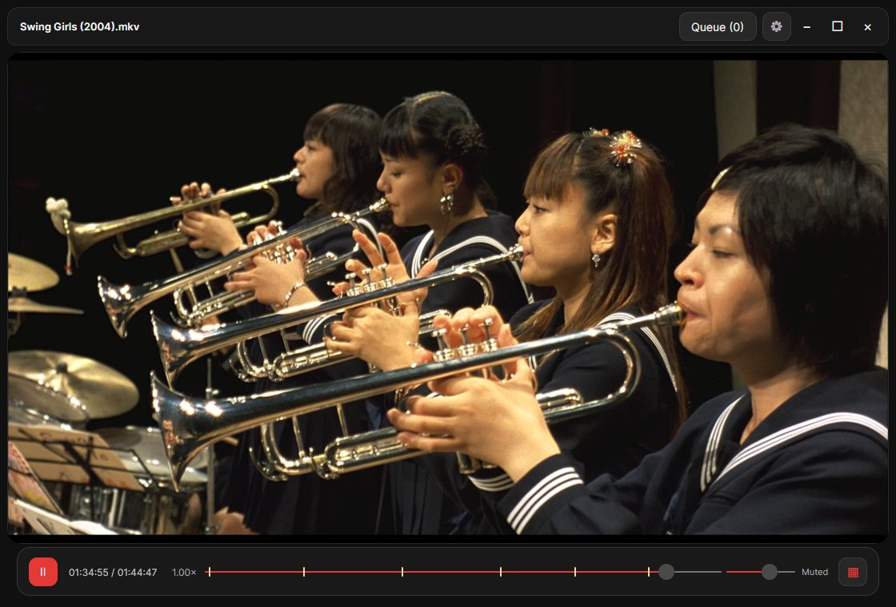
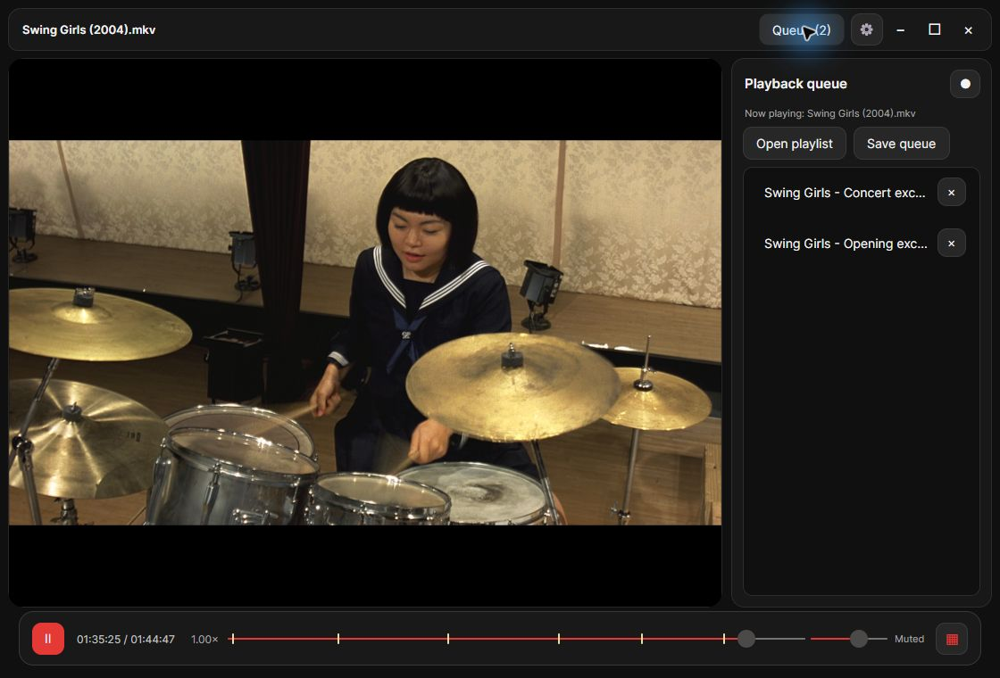
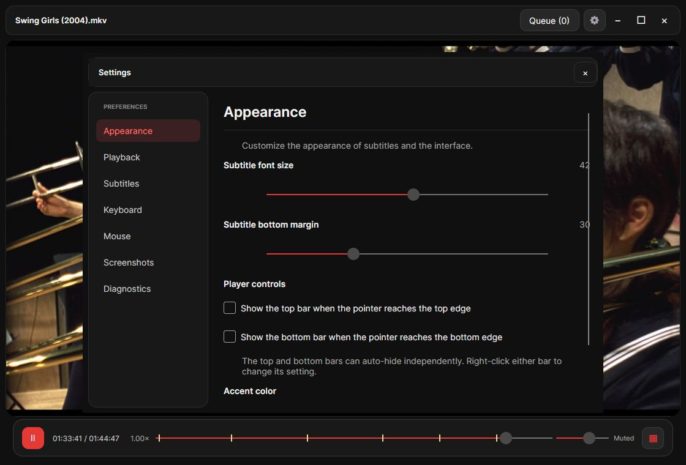

<div align="center">
  
  <h1>Pantheon</h1>
  <p><strong>Your video. Your controls. Nothing in the way.</strong></p>
  <p>A minimalist Windows video player with smart subtitles, frame previews and a fully customizable workflow.</p>

  [](https://github.com/kargalar/pantheon/releases/latest)
  [](https://github.com/kargalar/pantheon/releases/latest)
  [](LICENSE)
  [](https://github.com/kargalar/pantheon/actions/workflows/build.yml)

  <p><a href="https://github.com/kargalar/pantheon/releases/latest/download/Pantheon-win-x64.zip"><strong>Download for Windows ↓</strong></a> · <a href="docs/usage.md">User guide</a> · <a href="https://github.com/kargalar/pantheon/issues">Report an issue</a></p>
</div>



## Built around watching

Pantheon keeps the picture front and center. Its dark interface and red accents stay out of the way while you watch, then put playback, subtitles and your queue within reach. The interface is English throughout.

| Feature | What you can do |
| --- | --- |
| **Clean playback** | Open or drop a video, use hardware decoding, adjust playback speed, and switch audio or subtitle tracks. |
| **Smart subtitles** | Load matching local subtitles, find subtitles through OpenSubtitles, or align external subtitles to the selected audio with bundled FFsubsync. |
| **Visual seeking** | Scrub the timeline; hold and pull upward to reveal frame previews. Jump between chapters or step one frame at a time. |
| **A queue that follows you** | Automatically queue videos from the same folder, drag to reorder, and import or export M3U playlists. |
| **Pick up where you left off** | Remember playback positions, subtitle choices, speed and per-video subtitle timing. |
| **Make it yours** | Change the accent color, auto-hide controls, keyboard shortcuts and mouse actions across configurable video regions. |
| **Capture the moment** | Save subtitle-free PNGs at the source resolution. HDR frames use the player's SDR tone mapping. |

### Keep your next video close

Pin the queue or reveal it at the right edge. Play a video immediately, reorder the rest, or save the sequence as a playlist.



### Controls that fit you

Tune appearance, playback, subtitles, keyboard shortcuts and mouse regions from one settings window.



## Download and run

1. [Download **Pantheon-win-x64.zip**](https://github.com/kargalar/pantheon/releases/latest/download/Pantheon-win-x64.zip) from the latest release.
2. Extract the **entire ZIP** to a folder; keep the DLLs and `SubtitleTools` alongside the executable.
3. Run **`Pantheon.exe`**, then drag a video onto the window or press **O**.

The self-contained build includes the .NET runtime, libmpv and subtitle synchronization tools. You do not need to install .NET, Python or FFmpeg separately. The published package targets **64-bit Windows**; ARM64 and other operating systems are not packaged.

To register file types, run `Register-PantheonFileAssociations.ps1` from the extracted folder, then choose Pantheon in **Windows Settings > Apps > Default apps**. Registration does not replace your current defaults.

## A few useful shortcuts

| Action | Default shortcut |
| --- | --- |
| Open a video | **O** |
| Play / pause | **Space** |
| Seek backward / forward | **Left / Right** |
| Previous / next chapter | **Ctrl + Left / Right** |
| Fullscreen | **Enter** |
| Mute / toggle subtitles | **M / C** |
| Playback speed | **Numpad - / +** |
| Subtitle timing earlier / later | **Z / X** |
| Save a source-frame PNG | **S** or **"** |
| Open settings | **Tab** |

Keyboard and mouse bindings are editable. See the [full user guide](docs/usage.md) for timeline gestures, frame stepping, subtitles and file associations.

## Subtitles

Matching local subtitles and embedded tracks work without an online account. Online discovery requires your own [OpenSubtitles API key](https://opensubtitles.tawk.help/article/getting-started), entered in **Settings > Subtitles**, or supplied through `PANTHEON_OPENSUBTITLES_API_KEY`. Provider download quotas apply. Online search sends the video hash and title/episode metadata to OpenSubtitles; local playback itself does not require a network connection.

FFsubsync corrects time offsets and common framerate differences for external text subtitles. Original files are preserved. Differently edited releases may still need manual timing or another subtitle; converting styled ASS/SSA to SRT loses its styling. Read [subtitle setup and limitations](docs/usage.md#automatic-subtitles).

## Build from source

Requirements: **Windows x64** and the **.NET 10 SDK**.

```powershell
git clone https://github.com/kargalar/pantheon.git
cd pantheon
dotnet run --project .\src\VideoPlayer\VideoPlayer.csproj
```

```powershell
dotnet test .\Pantheon.slnx -c Release
dotnet publish .\src\VideoPlayer\VideoPlayer.csproj -c Release -r win-x64 --self-contained true -o .\dist\Pantheon
```

Source builds can play videos without the optional synchronization bundle. To prepare that bundle, install Python and FFmpeg (including ffprobe), run `.\tools\Build-SubtitleTools.ps1`, then build again. To create the portable ZIP with license notices and a SHA-256 checksum, run `.\tools\Build-Release.ps1`.

The application uses [.NET](https://github.com/dotnet/runtime), [Avalonia](https://github.com/AvaloniaUI/Avalonia), [libmpv](https://github.com/mpv-player/mpv) and [FFsubsync](https://github.com/smacke/ffsubsync). Development checks and runtime verification tools are described in the [user guide](docs/usage.md#build-and-tests).

## Contributing

Bug reports and focused pull requests are welcome. Include the steps to reproduce, your Windows version, and the affected media format when reporting playback issues. See [CONTRIBUTING.md](CONTRIBUTING.md) for the build and validation workflow. Keep API keys and private media paths out of reports.

## License and credits

Pantheon's original source code is [MIT licensed](LICENSE). Bundled dependencies retain their own licenses. The current Windows libmpv binary includes GPL features, and the separate FFmpeg tools are GPL-3.0-or-later; the MIT license does not replace their redistribution terms. Full notices, binary versions and upstream source links are in [ThirdPartyNotices.md](ThirdPartyNotices.md) and the distribution's `Licenses` directories.

Screenshots show the player running **Swing Girls (2004)**, directed by Shinobu Yaguchi. Film imagery belongs to its respective rights holders and is not covered by the MIT license. The movie is not included in the repository or download.
